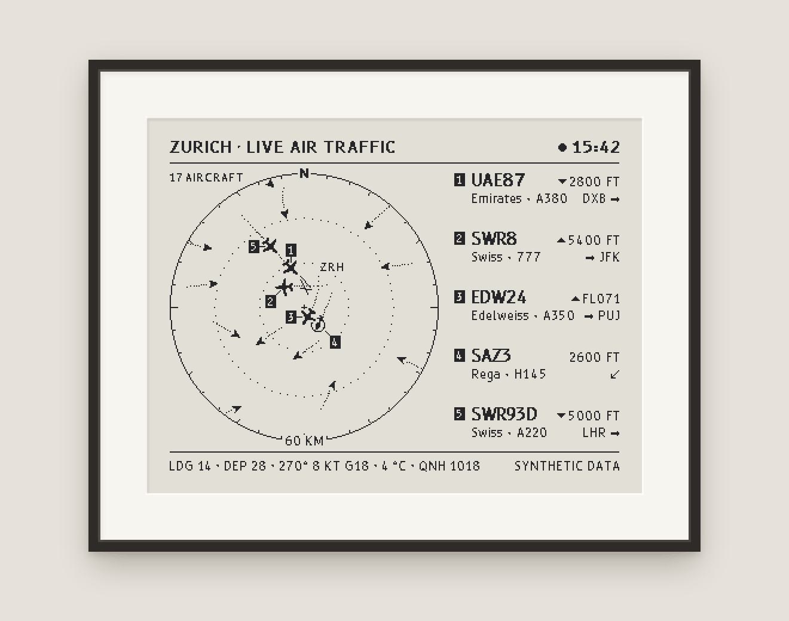
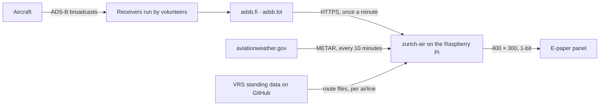
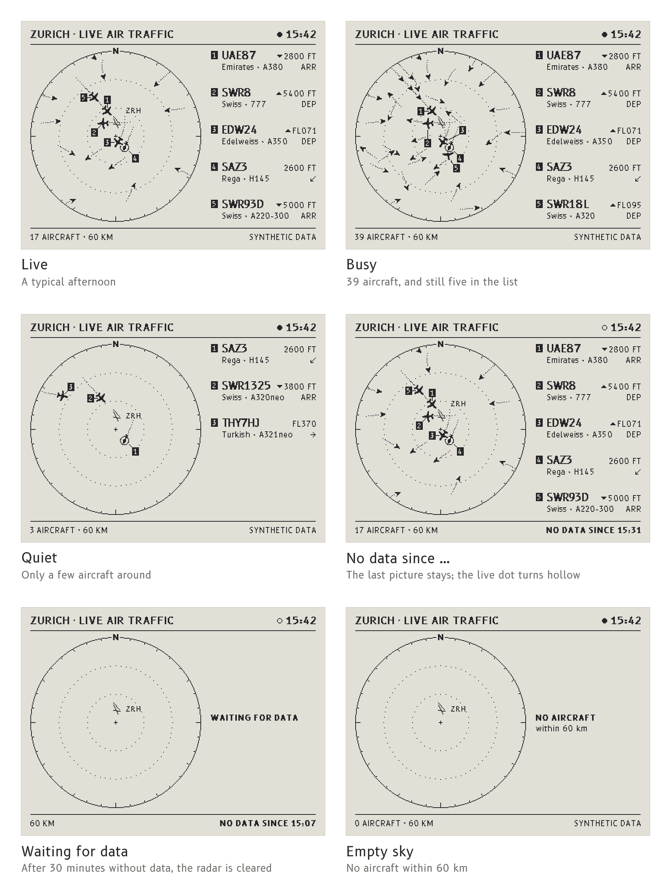

# Zurich Air

**Live air traffic around Zürich on a framed e-paper display: a quiet radar for the wall.**

[](https://github.com/nandometzger/zurich-air/actions/workflows/ci.yml)
[](LICENSE)
[](pyproject.toml)

<p align="center">
  
</p>
<p align="center"><sub>Mock-up rendered from synthetic data. Every flight in it is invented; it is not a photo of a device.</sub></p>

Zurich Air is a Raspberry Pi Zero 2 W behind a picture frame, driving a 4.2″ black-and-white
e-paper panel. Once a minute it asks free community ADS-B networks which aircraft are
around Zürich and draws those within 60 km on a radar, next to the five flights most worth
a look. E-paper suits a display that hangs on a wall: it reflects light like paper, has no
backlight, makes no sound, and keeps its picture even without power.

It began as a Christmas present for an aviation enthusiast, and it is built so that
anyone can make one.

> [!NOTE]
> **Status:** the software runs today on any computer and on the Pi, where it draws each
> frame to a PNG file (mock mode). The e-paper backend follows once the panel has been
> inspected. See [Project status](#project-status).

## Features

- **Radar** of 60 km around the city, north up, with range rings, the runway layout of
  Zürich Airport, aircraft pointing the way they fly and short dotted trails.
- **Five featured flights**, chosen by a ranking you can read: arrivals and departures at
  ZRH, rare and very large aircraft, helicopters, Rega air rescue, military traffic and
  low flyers score points; emergencies always come first. `zurich-air explain` prints
  every score and the reason behind it.
- **A calm list.** Rows keep their place until a newcomer is clearly more interesting.
- **Routes, only when they check out**: `DXB →`, `→ JFK`, `LHR → IST`, shown only when the
  aircraft is seen flying that route. Many rows have none; none is ever guessed.
- **Airport line.** The runways in use, worked out from the aircraft seen using them, and
  the airport's wind, temperature and QNH from its latest weather report (METAR).
- **Honest about its data.** After 5 minutes without new data it says `NO DATA SINCE`;
  after 30 it clears the radar rather than show aircraft long gone. Whatever is not known
  is left out.
- **Quiet hours.** From 23:30 to 06:00 it updates every 10 minutes instead of every minute.
- **Privacy.** Aircraft whose owners opted out of tracking (LADD) or fly with a privacy
  address (PIA) are never named and their routes never looked up: they stay anonymous
  markers on the radar.
- **Free data, no account.** [adsb.fi](https://adsb.fi), with [adsb.lol](https://adsb.lol)
  as fallback, and [aviationweather.gov](https://aviationweather.gov). The route table is
  kept offline: only an airline code (at most with one digit) leaves the device.
- **Runs unattended** as a systemd service with a watchdog, restarts after crashes and
  hangs, starts without a network and recovers from outages by itself.
- **One renderer.** A preview on your laptop is pixel for pixel what the panel will show.
- **Small.** Python 3.11+, one runtime dependency (Pillow), a TOML file for another city,
  metric altitudes or your own ranking.

## Reading the display

<p align="center">
  
</p>
<p align="center"><sub>Rendered from synthetic data.</sub></p>

The radar on the left is a map seen from above, with Zürich at the centre and true
distances: dotted rings at 20 and 40 km, the solid edge at 60 km. Numbered aircraft match
the rows on the right: callsign, altitude with ▲ climbing or ▼ descending, airline and
type, and a checked route (`→ JFK`), else `ARR`, `DEP` or an arrow for the direction of
flight. The footer gives the runways in use, the airport's weather and the data source;
the dot beside the clock is filled while fresh data arrives.
**[Reading the display](docs/reading-the-display.md)** explains every element, the units
and how the five are chosen, without assuming any technical knowledge.

## How it works



Zurich Air does not receive radio signals itself. Once a minute it asks a community network
for every aircraft around the city, filters and ranks them, draws a black-and-white frame
and sends it to the display only if it changed. Along the way it infers the runways in
use, fetches the airport's weather every ten minutes and checks the listed flights' routes.

<p align="center">
  
</p>
<p align="center"><sub>Fourteen minutes, one frame per minute, from synthetic data in which every aircraft flies straight on.</sub></p>

[How it works](docs/how-it-works.md) follows the data from transponder to pixel: the
pipeline, the ranking, the runways in use, the route checks, the radar, 1-bit rendering
and how it keeps running for months.

<details>
<summary><b>Every state of the display</b>: live, busy, quiet, no data, waiting for data, empty sky</summary>
<br>
<p align="center">
  
</p>
<p align="center"><sub>Rendered from synthetic data.</sub></p>
</details>

## Quick start

Try it in a minute, without hardware. You need [uv](https://docs.astral.sh/uv/), which
fetches a suitable Python by itself.

```sh
git clone https://github.com/nandometzger/zurich-air.git
cd zurich-air
uv sync
uv run zurich-air preview                   # synthetic scenes → previews/typical.png, …
uv run zurich-air explain --scene typical   # why these five? every score and reason
uv run zurich-air doctor --offline          # self-check, no network requests
```

`preview` renders six invented scenes (`typical`, `busy`, `quiet`, `empty`, `degraded`,
`stale`); add `--scale 3` for enlarged copies. With a network connection, try live traffic:

```sh
uv run zurich-air once     # fetch once → previews/latest.png
uv run zurich-air run      # update every minute until Ctrl-C
```

[Development](docs/development.md) covers saving real traffic and replaying it offline.

## Build your own

| Part | Notes |
| --- | --- |
| Raspberry Pi Zero 2 W with headers ("Zero 2 WH") | Header pre-soldered; Wi-Fi is 2.4 GHz only. |
| Waveshare 4.2″ e-Paper, 400 × 300, black and white | SPI. The exact variant is confirmed once the panel has been inspected. |
| microSD card, 16–32 GB, A1 | An "endurance" card suits a device that runs around the clock. |
| Power supply, 5 V 2.5 A, micro-USB | Into the port labelled PWR IN. |
| Picture frame | To be chosen (Milestone 8). |

[Hardware](docs/hardware.md) explains the choices and the published power figures. The
[Raspberry Pi guide](docs/raspberry-pi.md) then takes you, in about an hour, from a blank
card to a running service:

1. **Flash** Raspberry Pi OS Lite (64-bit) with Raspberry Pi Imager, filling in the
   hostname `zurich-air`, your user, Wi-Fi and SSH key.
2. **Log in** with `ssh <user>@zurich-air.local`, update the system and enable SPI.
3. **Install** with one script, which sets up the service and finishes with
   `zurich-air doctor`:

   ```sh
   sudo apt install -y git
   git clone https://github.com/nandometzger/zurich-air.git ~/zurich-air
   ~/zurich-air/scripts/install-pi.sh
   ```

4. **Done.** It updates every minute and starts at every boot.
   `journalctl -u zurich-air -f` shows what it is doing.

> [!IMPORTANT]
> The e-paper backend lands once the panel has been inspected (Milestone 6). Until then
> the Pi runs in **mock mode** and draws each frame to `~/zurich-air/previews/latest.png`.
> The guide was written before the hardware arrived: steps not yet run on a device are
> marked *Untested*. If something differs on yours, please
> [open an issue](https://github.com/nandometzger/zurich-air/issues).

## Configuration

Every setting is optional and defaults to Zürich. Copy
[`config.example.toml`](config.example.toml) to `config.toml` and change what you like:

```toml
[display]
altitude_units = "metric"     # 10 360 M instead of FL340

[update]
quiet_hours = "01:00-05:00"   # update every 10 minutes only in these hours

[ranking.weights]
helicopter = 40               # helicopters rank higher
```

```sh
uv run zurich-air once --config config.toml
```

On the Pi the installer creates `~/zurich-air/config.toml`; restart the service after
editing it. [Configuration](docs/configuration.md) lists every key and has recipes for
another city or airport, a different radar range and tuning the ranking.

## Documentation

| Page | What it covers |
| --- | --- |
| [Reading the display](docs/reading-the-display.md) | Every element on the screen, the units, and how the five flights are chosen. |
| [Hardware](docs/hardware.md) | The parts, why they were chosen, power figures and other displays. |
| [Raspberry Pi setup](docs/raspberry-pi.md) | From a blank microSD card to a running service, updates and hand-over. |
| [Configuration](docs/configuration.md) | Every setting with its default, and recipes. |
| [Troubleshooting](docs/troubleshooting.md) | What the log and the display are telling you, and how to fix it. |
| [How it works](docs/how-it-works.md) | Pipeline, ranking, runways in use, route checks, weather, radar, 1-bit rendering and reliability. |
| [Data sources](docs/data-sources.md) | adsb.fi, adsb.lol, aviationweather.gov, the VRS routes and OurAirports: terms, rate limits, what is sent, privacy. |
| [Development](docs/development.md) | Setup, project layout, previews, snapshots, tests and CI. |
| [Roadmap](ROADMAP.md) | What is left for v1, and ideas beyond it. |
| [Contributing](CONTRIBUTING.md) | How to propose a change. |

## Data sources and attribution

Flight data comes from [adsb.fi](https://adsb.fi) (default; free for personal,
non-commercial use, attribution required) and, as a fallback, from
[adsb.lol](https://adsb.lol) (data under the
[Open Database License 1.0](https://opendatacommons.org/licenses/odbl/1-0/)). Both collect
the reports of receivers run by volunteers. The display's footer names the source of the
data on screen.

ADS-B carries no flight plan: routes come from the Virtual Radar Server
[standing data](https://github.com/vradarserver/standing-data) (CC0), verified against what
the aircraft is seen doing, never guessed. The weather is the airport's METAR from
[aviationweather.gov](https://aviationweather.gov) (public domain); airports and runways
come from [OurAirports](https://ourairports.com/) (public domain). If you build one, you
are responsible for following each provider's current terms: [Data sources](docs/data-sources.md).

## Project status

v1 is due by Christmas 2026.

- [x] Tooling and CI, radar geometry and the 1-bit design
- [x] Live data from adsb.fi with adsb.lol fallback
- [x] Explainable ranking and `zurich-air explain`
- [x] Raspberry Pi installer, systemd service and setup guide
- [x] Reliability: watchdog, quiet hours, outage handling, `zurich-air doctor`
- [x] Documentation
- [x] From v2: the airport line and verified routes (pending verification on the device)
- [ ] E-paper backend, once the panel has been inspected (Milestone 6)
- [ ] Verification on the device: watchdog, boot with and without network, render time
- [ ] The frame (Milestone 8)
- [ ] Final docs with photos

[ROADMAP.md](ROADMAP.md) has the details and ideas for later, such as a receiver of its
own and a logbook of the day at ZRH.

## Contributing

Issues and pull requests are welcome. Zurich Air is a small hobby project: keep changes
small, rendering hardware-independent and the data honest.
[CONTRIBUTING.md](CONTRIBUTING.md) explains the process; [Development](docs/development.md)
gets you set up.

## License

[MIT](LICENSE). The bundled [B612](https://github.com/polarsys/b612) typeface, designed by
Airbus for cockpit displays, is © 2012 The B612 Project Authors and licensed under the
[SIL Open Font License 1.1](src/zurich_air/assets/fonts/OFL.txt).

## Acknowledgements

- [adsb.fi](https://adsb.fi) and [adsb.lol](https://adsb.lol), for open flight data.
- The volunteers who run ADS-B receivers and share what they hear.
- The [standing data](https://github.com/vradarserver/standing-data) of Virtual Radar
  Server by vradarserver and its contributors, for the routes (CC0).
- [aviationweather.gov](https://aviationweather.gov) of the US National Weather Service
  (NOAA), for the METARs (public domain; no endorsement by the NWS is implied).
- [OurAirports](https://ourairports.com/), for the airports and runways (public domain).
- The [B612](https://github.com/polarsys/b612) project, for a typeface made to be read at
  a glance, and [Pillow](https://python-pillow.org/), which draws every pixel.
