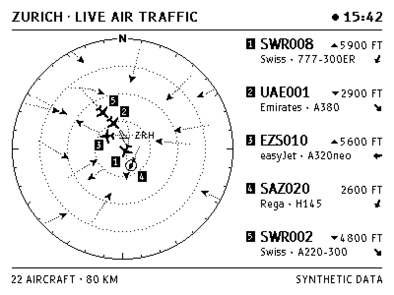

# Zurich Air

A minimalist, framed e-paper display showing live air traffic around Zürich — built with a
Raspberry Pi Zero 2 W and a 4.2″ Waveshare e-paper panel.

<p align="center">
  
</p>

<sub>Rendered from synthetic data (400 × 300 px, 1-bit, shown at 2×).</sub>

> **Status:** early development. The renderer and mock display run on any machine;
> hardware integration follows once the panel arrives.

## Development setup

Requires [uv](https://docs.astral.sh/uv/) (it installs the right Python automatically).

```sh
git clone https://github.com/nandometzger/zurich-air.git
cd zurich-air
uv sync            # creates .venv with Python 3.13 and all dev tools
uv run pytest      # run the test suite
uv run ruff check  # lint
uv run zurich-air preview --scale 3   # render synthetic scenes to previews/
```

## License

MIT — see [LICENSE](LICENSE). The bundled [B612](https://github.com/polarsys/b612) typeface
is licensed under the SIL Open Font License 1.1.
