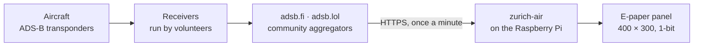
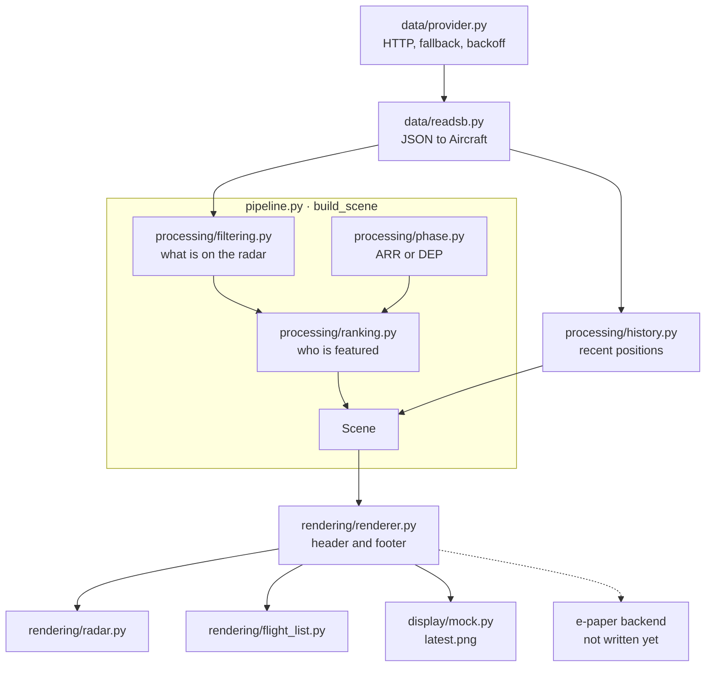
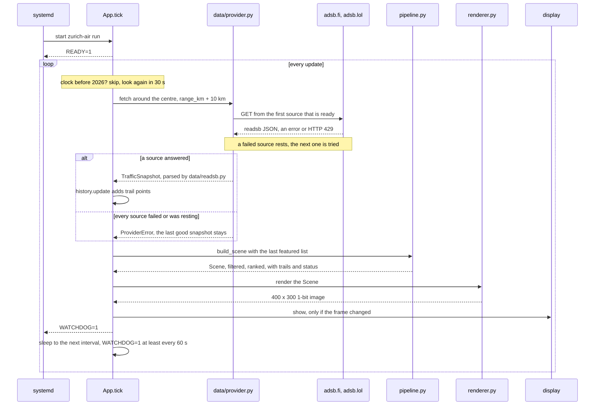
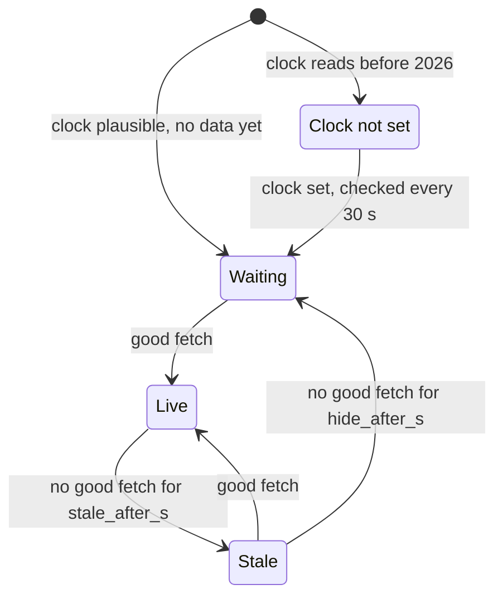

# How it works

This page follows the data from an aircraft's transponder to a pixel on the e-paper panel,
and explains the decisions along the way: which aircraft are featured, how the radar is
drawn, how the display copes with outages, and how it keeps running for months. For what
each element on the screen means, see [Reading the display](reading-the-display.md); for
every setting mentioned here, see [Configuration](configuration.md).

- [The big picture](#the-big-picture)
- [The pipeline](#the-pipeline)
- [One update, step by step](#one-update-step-by-step)
- [Data freshness](#data-freshness)
- [Choosing the five aircraft](#choosing-the-five-aircraft)
- [The radar](#the-radar)
- [Rendering for 1-bit e-paper](#rendering-for-1-bit-e-paper)
- [Reliability](#reliability)

## The big picture

Most airliners and many smaller aircraft continuously broadcast their identity, position,
altitude and velocity by ADS-B; volunteers' receivers pick these messages up and share
them with community networks, which anyone can query.



Zurich Air does not receive radio signals itself. Once a minute it asks an aggregator for
every aircraft within a circle around the city, decides what to show, draws a
black-and-white picture and puts it on the display. Which services it uses, and on which
terms, is described in [Data sources](data-sources.md).

The e-paper driver is not written yet (it is Milestone 6 and waits for the panel). Until
then the same picture is written to `previews/latest.png` by the mock display.

## The pipeline

Every frame goes through the same chain of small modules. The live app and the `preview`
command share it from the parsed snapshot onwards, so a preview shows exactly what the
panel would.



| Stage | Module | What it does |
| --- | --- | --- |
| Fetch | `data/provider.py` | Asks the configured sources in order, each with its own rate limit and backoff. |
| Parse | `data/readsb.py` | Turns readsb JSON into `Aircraft` records. Any field may be missing or malformed: a bad value becomes "unknown" and never raises. Only entries without an address or a valid position are dropped. |
| Trails | `processing/history.py` | Remembers recent positions per aircraft, because the services only report where an aircraft is now. |
| Filter | `processing/filtering.py` | Keeps what belongs on the radar (see [below](#choosing-the-five-aircraft)). |
| Phase | `processing/phase.py` | Infers arrival or departure from altitude, vertical rate and track. |
| Rank | `processing/ranking.py` | Scores every candidate and picks the featured aircraft. |
| Scene | `pipeline.py` | `build_scene` combines all of the above with the data's age into a `Scene`: everything one frame shows. |
| Render | `rendering/` | Draws the scene into a 1-bit image: `renderer.py` composes header and footer, `radar.py` the scope, `flight_list.py` the rows. The renderer draws exactly the scene and invents nothing. |
| Show | `display/` | `mock.py` writes PNG files. Every backend implements the two-method interface in `display/base.py` (`show`, `close`), the e-paper one included once it exists. |

## One update, step by step

On the Pi, systemd runs `zurich-air run`, which creates an `App` (`app.py`) and calls
`App.tick` once per interval until it is stopped.



In more detail:

1. **Clock check.** If the system clock reads a date before 1 January 2026, the update is
   skipped entirely (no fetch, no drawing) and the app looks again after 30 seconds. See
   [Reliability](#reliability) for why.
2. **Fetch.** The provider is asked for aircraft within `radar.range_km` plus 10 km of the
   radar centre (70 km by default), so that an aircraft entering the scope already has a
   trail. It tries the sources in `provider.sources` order and skips one that is still
   resting after an error or whose minimum request interval has not passed. After HTTP
   429 (rate limited) a source rests for as long as the service's `Retry-After` header
   asks, or 10 minutes without one; after other errors it backs off for 30 s, 1 min,
   2 min, then 5 min. The details are in [Data sources](data-sources.md#fallback-backoff-and-rate-limits).
3. **Parse and remember.** The response is parsed by `data/readsb.py`, and every position
   is added to the track history. If no source delivered, the last good snapshot is kept
   and the scene will age (see [Data freshness](#data-freshness)).
4. **Build the scene.** `build_scene` filters the aircraft, infers flight phases, ranks
   the candidates (passing in the previous frame's flight list, so it stays calm), looks
   up the trails and decides whether the data is live, stale or too old to show.
5. **Render.** The renderer draws a 400 × 300 image with one bit per pixel.
6. **Show.** The image is compared with the frame already on the display; only a frame
   that differs is sent. If showing fails three times in a row, the app exits so that
   systemd restarts it.
7. **Report.** One line per update goes to the log, for example
   `update: adsb.fi, live, 23 aircraft, featured SWR8 EZY12 DLH4, display refreshed`, and
   once an hour a summary. Then the app tells systemd it is alive (`WATCHDOG=1`).
8. **Sleep.** The next update lands just after the next whole multiple of
   `update.interval_s` (60 s: on the minute, plus one second), and never sooner than two
   seconds after the previous update. During quiet hours (`update.quiet_hours`, 23:30 to
   06:00 by default) the interval is `update.quiet_interval_s` (600 s), but the first
   update after the quiet hours still comes on time. While it sleeps, the app pings the
   watchdog at least every 60 seconds.

## Data freshness

When the services cannot be reached, the display neither freezes on old traffic nor
blanks at the first hiccup. The scene has three states, measured by the age of the last
good fetch (taken from the Pi's own clock when the data arrived, so a service whose clock
runs fast or slow cannot flip the state), and updates pause while the system clock is
not set:



| State | When | Header dot | Radar | Flight list | Footer |
| --- | --- | --- | --- | --- | --- |
| Live | last good fetch at most `update.stale_after_s` (300 s) ago | filled | aircraft and trails | featured rows, or `NO AIRCRAFT` `within 60 km` | `17 AIRCRAFT · 60 KM` and the source, e.g. `ADSB.FI` |
| Stale | older than that, at most `update.hide_after_s` (1800 s) | hollow ring | last known aircraft | last rows | `17 AIRCRAFT · 60 KM` and **`NO DATA SINCE 15:31`** |
| Waiting | no data since start, or older than `update.hide_after_s` | hollow ring | empty scope: rings, compass, airport | `WAITING FOR DATA` | `60 KM` and **`NO DATA SINCE 15:31`**, or just **`NO DATA`** if nothing ever arrived |
| Clock not set | system clock before 2026-01-01 | — | — | — | — |

The time after `NO DATA SINCE` is the time of the last good data, in `location.timezone`.
Clearing the radar after half an hour means aircraft that are long gone never pass for
current traffic. While the clock is not set, nothing is fetched or drawn, so the display
keeps whatever it showed before.

Any good fetch returns the display to Live.

## Choosing the five aircraft

### What is on the radar

Before ranking, `processing/filtering.py` decides what is plotted at all. An aircraft is
shown when it is:

- **one entry per ICAO address** (the one with the freshest position);
- **an aircraft**: airport vehicles and obstacles also transmit ADS-B (emitter categories
  C1 to C5) and are dropped;
- **airborne**, unless `aircraft.include_ground` is set. Some transponders report
  "airborne" while parked, so a report slower than 5 kt and no more than 600 ft above
  `airport.elevation_ft` also counts as on the ground;
- **recent**: its position is at most `aircraft.stale_after_s` (60 s) old;
- **below the ceiling** of `aircraft.max_altitude_ft` (60 000 ft); an unknown altitude
  passes;
- **inside the radar range** of `radar.range_km` (60 km) from the centre.

### Scores

The flight list shows the `aircraft.featured` (5) aircraft with the highest scores. A score
is a sum of small, independent components, each looking at one aspect and contributing
points from `[ranking.weights]`:

| Component | Default points | When | `explain` shows |
| --- | --- | --- | --- |
| Emergency | +1000, fixed | squawk 7500, 7600 or 7700, or an emergency status | `emergency 7700` |
| `arrival` | 40 | inferred arrival; full at the airport, half at `ranking.phase_radius_km` | `arrival ZRH 11 km` |
| `departure` | 40 | inferred departure; scaled like arrivals | `departure ZRH 10 km` |
| `notable_type` | 30 | very large or rare types: A124, A337, A388, A3ST, A400, B744, B748, BLCF, C17, IL76, MD11 | `notable A388` |
| `widebody` | 10 | other widebody types | `widebody B77W` |
| `helicopter` | 15 | emitter category A7 or a known helicopter type | `helicopter` |
| `rescue` | 15 | air rescue callsign (prefix `SAZ`, Rega) | `air rescue` |
| `military` | 25 | flagged military in the aircraft database | `military` |
| `interesting` | 15 | flagged interesting in the aircraft database | `flagged interesting` |
| `low_altitude` | 20 | full at 0 ft, fading to nothing at 40 000 ft | `2816 ft` |
| `near_centre` | 10 | full at the radar centre, nothing at its edge | `19 km from centre` |
| `no_identity` | −20 | neither callsign nor type: an uninformative row | `no callsign or type` |
| `featured_before` | 15 | in the flight list of the previous frame | `featured before` |

Emergencies are sorted first whatever the other points; each weight must lie between −100
and 100, and `featured_before` must not be negative. The type lists and the rescue prefix
live in `data/reference.py`; the military and interesting flags come from the data
service's aircraft database (`dbFlags`).

### Arrival or departure

ADS-B carries no flight plan, so the phase is read from the kinematics alone
(`processing/phase.py`). Within `ranking.phase_radius_km` (40 km) of the airport:

- **Arrival:** at or below `ranking.arrival_max_altitude_ft` (10 000 ft), descending at
  least `ranking.min_vertical_rate_fpm` (300 ft/min), or level and no more than 2000 ft
  above the field, with its track within `ranking.max_track_offset_deg` (75°) of the
  direct line to the airport.
- **Departure:** at or below `ranking.departure_max_altitude_ft` (15 000 ft), climbing at
  least 300 ft/min, with its track within 75° of the direct line away from the airport.

The inference is deliberately conservative. Without altitude, vertical rate or track, on
the ground, for helicopters (they fly between pads, not along the runways), or when the
geometry is ambiguous, such as on a downwind leg, there is no phase. The list then shows an
arrow along the track, if there is one, instead of `ARR` or `DEP`: no label rather than a
wrong one.

### Order and stickiness

Candidates are sorted by emergency first, then score, then ICAO address, so the result is
deterministic. On top of that, the list is kept calm, so that the e-paper only changes
when something worth showing does:

- an aircraft that was featured in the previous frame gets the `featured_before` bonus
  (15), so a newcomer must be clearly more interesting to take its place;
- rows stay where they are: aircraft that remain featured keep their order, a newcomer is
  slotted in above the first row it outscores, and rows only move up when one above
  leaves;
- an emergency always goes to the top.

### Privacy

Aircraft whose owners opted out of public tracking (LADD) or that fly with a temporary
privacy address (PIA) are never featured: no number, no row, no callsign. They remain on
the radar as anonymous markers, like any other unfeatured aircraft, and the log never
names them, because it only lists the featured callsigns. `explain` counts them as
"withheld for privacy" without listing them.

### An example

This is the report `zurich-air explain` produces, here for the synthetic `typical` scene:
an invented afternoon at Zürich, not real traffic, hence `synthetic data` in the first
line. `uv run zurich-air explain --scene typical` reproduces it, without network. It is
trimmed to the first ten rows; the dashed line marks where the flight list ends.

```text
2026-12-24 15:42:00 · synthetic data · 17 aircraft on the radar, 0 withheld for privacy (LADD/PIA)

  #  FLIGHT    TYPE       ALT    ZRH  PHASE  SCORE  REASONS
  1  UAE87     A388   2816 ft  11 km  ARR       90  arrival ZRH 11 km +35, notable A388 +30, 2816 ft +19, 19 km from centre +7
  2  SWR8      B77W   5400 ft  10 km  DEP       70  departure ZRH 10 km +35, widebody B77W +10, 5400 ft +17, 13 km from centre +8
  3  EDW24     A359   7100 ft  13 km  DEP       69  departure ZRH 13 km +33, widebody A359 +10, 7100 ft +16, 5 km from centre +9
  4  SAZ3      EC45   2600 ft  18 km            57  helicopter +15, air rescue +15, 2600 ft +19, 10 km from centre +8
  5  SWR93D    BCS3   5016 ft  24 km  ARR       50  arrival ZRH 24 km +28, 5016 ft +17, 31 km from centre +5
     ---------------------------------------- not featured
  6  OAW726    E295  12000 ft  31 km  DEP       45  departure ZRH 31 km +24, 12000 ft +14, 22 km from centre +6
  7  DLH5LU    CRJ9   7000 ft  34 km  ARR       42  arrival ZRH 34 km +23, 7000 ft +16, 43 km from centre +3
  8  HBCXB     C172   3500 ft  32 km            24  3500 ft +18, 25 km from centre +6
  9  BAW8KN    A320  10000 ft  41 km            18  10000 ft +15, 42 km from centre +3
 10  AUA57T    E195  11000 ft  37 km            18  11000 ft +14, 41 km from centre +3
```

Row 1 adds up as follows: an arrival 11 km from the airport earns 40 × (1 − 0.5 × 11/40)
≈ 35 points, the A380 is a notable type (30), 2816 ft is low (20 × (1 − 2816/40 000) ≈
19) and it is 19 km from the centre (10 × (1 − 19/60) ≈ 7), 90 in total. The Rega
helicopter in row 4 has no phase, but helicopter and air rescue together lift it above
the later arrivals.

Run `zurich-air explain` to see the same table for live traffic, a saved snapshot or
another synthetic scene ([Development](development.md#explain-the-ranking)), and see
[Configuration](configuration.md#tune-the-ranking) for adjusting the weights.

## The radar

**Projection.** The scope uses an azimuthal equidistant projection centred on
`location`: every aircraft is placed at its true great-circle distance and initial
bearing from the centre, north up. Within a radius of some 100 km this is effectively
exact and needs no map library (`processing/geo.py`). At 400 × 300 px the scope has a
radius of 112 px, so 60 km come to about 1.9 px per km.

**Scale.** The outer ring is solid and marks `radar.range_km` (60 km). Dotted inner rings
follow every `radar.ring_step_km` (20 km); their dots are 7 px apart, sparse enough to
recede behind the traffic. Compass ticks sit inside the outer ring every 10°, longer at
30° and 90°, with an `N` set into the ring at the top. A small cross marks the centre.

**Airport.** The runways from `airport.runways` are drawn as a glyph: the real layout,
enlarged around its centre to a radius of 9 px, so that the runway directions can be
read. Without runway data, a small ring marks the airport. The airport code goes beside
the glyph on the first side that is free of aircraft and badges (right, left, below,
above, then the corners), and is left out when traffic surrounds the airport.

**Aircraft.** Featured aircraft are drawn as a 15 px airliner silhouette (a helicopter seen
from above for helicopters), all others as a 9 px dart, each rotated to its track; an
aircraft without a track is a small square. The symbols are rasterised at 8× and
thresholded, which keeps them symmetric at these sizes, and each gets a one-pixel white
halo so that it stands out from rings and trails. Featured aircraft are drawn last, with
#1 on top.

**Trails.** Each aircraft keeps up to 8 positions from the last 10 minutes (an aircraft not
reported for 5 minutes is forgotten). Its trail is drawn as dots that start 2 px apart and
grow sparser with distance, so it fades out instead of ending abruptly, and is capped at
28 px behind featured aircraft and 18 px behind others, so fast jets do not streak across
the scope. Dotted, a trail never reads as a leader line; dense, never as a range ring.
Traffic is clipped to the scope's circle.

**Badges.** Each featured aircraft carries a numbered black badge (9 × 11 px), joined to
its marker by a short leader line, as in an air traffic controller's data block, so every
number points at exactly one aircraft even in the cluster around the airport. Badges are
placed in list order. For each one, 16 directions (horizontal, vertical, 45° and regular
2:1 staircases, so every leader is a crisp line) and every leader length from 5 to 24 px
are scored:

- covering another marker, badge, leader or landmark is all but ruled out, as is leaving
  the scope;
- lying among the compass ticks, covering trails or runway strokes, or sitting within
  12 px of another aircraft (where it could be read as that aircraft's label) costs
  points;
- so does pointing into a crowd rather than away from it, or along the aircraft's track
  ahead (it would read as a speed vector) or astern (along its trail);
- shorter leaders and the up-and-right direction are preferred when all else is equal.

The cheapest position wins and is blocked for the badges that follow. If no position
inside the scope exists, the badge sits on its aircraft.

## Rendering for 1-bit e-paper

The panel shows black or white, nothing in between, so the renderer works in Pillow's
mode `"1"` from the start rather than converting a greyscale picture at the end.

- **Typeface.** All text is [B612](https://github.com/polarsys/b612), the typeface Airbus
  designed for cockpit displays, bundled under the SIL Open Font License. Drawn onto a
  1-bit image, it is rasterised without anti-aliasing, so every glyph lands on whole
  pixels.
- **Four sizes.** 13 px for the header and 14 px for callsigns (both bold), 10 px for
  altitudes, second lines and the footer, 9 px for radar labels and badge digits. At these
  sizes B612's hinted Regular cut sits on a perfectly even baseline.
- **Synthetic bold.** Bold is Regular struck twice, one pixel apart. B612's Bold cut ships
  without hinting instructions, and FreeType's auto-hinter would set some letters one
  pixel higher than others: a visible wobble in 1-bit. Only the Regular cut is bundled.
- **Placed by ink.** Text is positioned by its baseline and the edges of its actual ink,
  so left and right edges line up exactly across rows. Letter-spaced labels are set glyph
  by glyph with an even gap between the inked shapes.
- **Same pixels everywhere.** Fonts are loaded with Pillow's basic layout engine. Pillow
  builds with libraqm (as on Linux, so on the Pi) would otherwise shape text with
  HarfBuzz and set it at different widths than builds without it (as on macOS); with the
  basic engine, a preview on a laptop matches the panel pixel for pixel.
- **Small symbols by hand.** Arrows point in one of eight directions and are drawn as
  1 px lines like the strokes of the text beside them; climb and descent marks are solid
  triangles.
- **Shortened by meaning.** When the operator and model do not fit, the description gives
  way step by step (`Swiss · 777-300ER` → `Swiss · 777` → `777-300ER` → `777`), never with
  an ellipsis. Missing fields are left out; nothing is guessed.

## Reliability

The device is meant to hang on a wall for months without anyone looking after it.

**No single failure stops the display.** Each stage of an update (fetch, build, render,
display) is guarded. A provider error keeps the last good data, shown stale and later
hidden. An unexpected exception is logged, with its full traceback at most once an hour
for each kind, and the next update carries on.

**Watchdog.** The systemd service is of `Type=notify`. The app reports `READY=1` when it
starts, `WATCHDOG=1` after every update and at least every 60 seconds while it waits
(also during the 10-minute quiet-hours interval), and `STOPPING=1` when it stops. With
`WatchdogSec=5min`, five minutes of silence mean the process hangs, and systemd kills and
restarts it.

**Restarts.** `Restart=always` restarts the service after a crash, a watchdog timeout or a
deliberate exit. Restarts back off: 30 s, 1 min, 2 min, 5 min, then every 10 minutes. The
only deliberate exit is a display that fails three times in a row: the app then exits
with status 1, so that systemd starts it afresh.

**Quiet hours.** From 23:30 to 06:00 local time the app updates every 10 minutes instead of
every minute: fewer requests to the data services and fewer panel refreshes while there is
little traffic.

**Small footprint.** The mock display keeps only `latest.png`, replaced atomically so that
a reader never sees half a file; keeping every frame (`--keep-frames`) would fill the SD
card at some 6 MB a day. The track history is bounded too (8 positions per aircraft, at
most 2000 aircraft).

**Starting without a synchronised clock.** The Pi has no battery-backed clock and boots
with a time from the past until NTP corrects it over the network. The service waits for
the network (`After=network-online.target`) but deliberately not for time
synchronisation: with the network down at boot it would never start, and the panel would
keep its last picture, live dot included. Instead it starts at once and shows
`WAITING FOR DATA`. Only while the clock reads a date before 2026 does it neither fetch
(HTTPS would fail anyway) nor draw a wrong time, and it checks again every 30 seconds.

**Logs.** One line per update, a summary every hour, warnings and errors with their
journal priority (so `journalctl -u zurich-air -p warning` lists only problems). See
[Troubleshooting](troubleshooting.md) for what the messages mean and
[Raspberry Pi setup](raspberry-pi.md) for the service itself.
