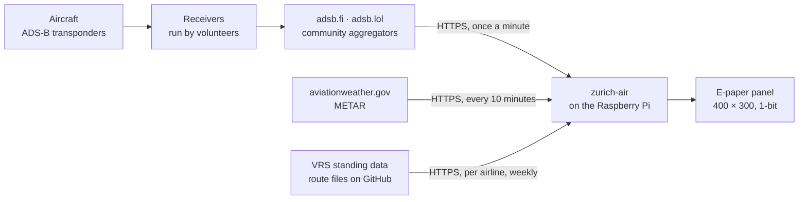
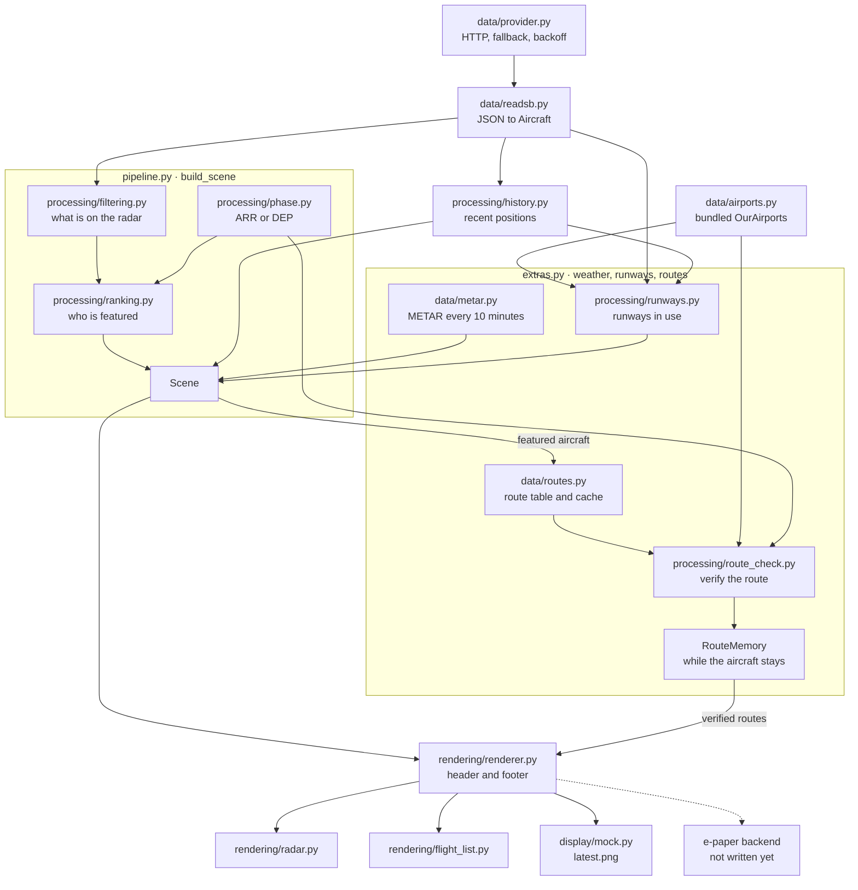
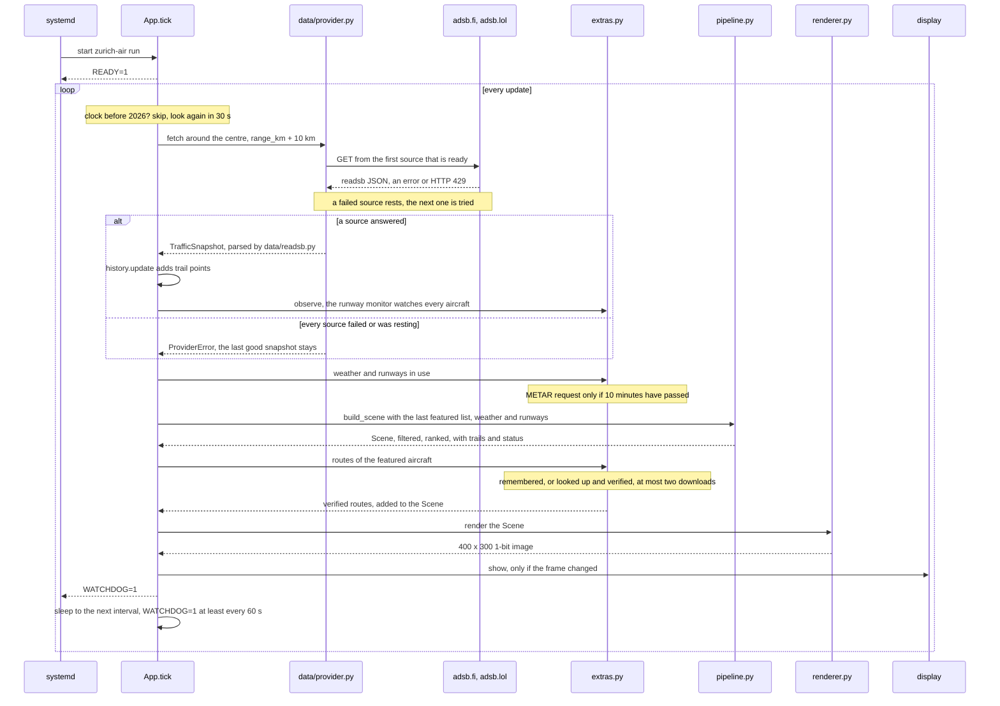
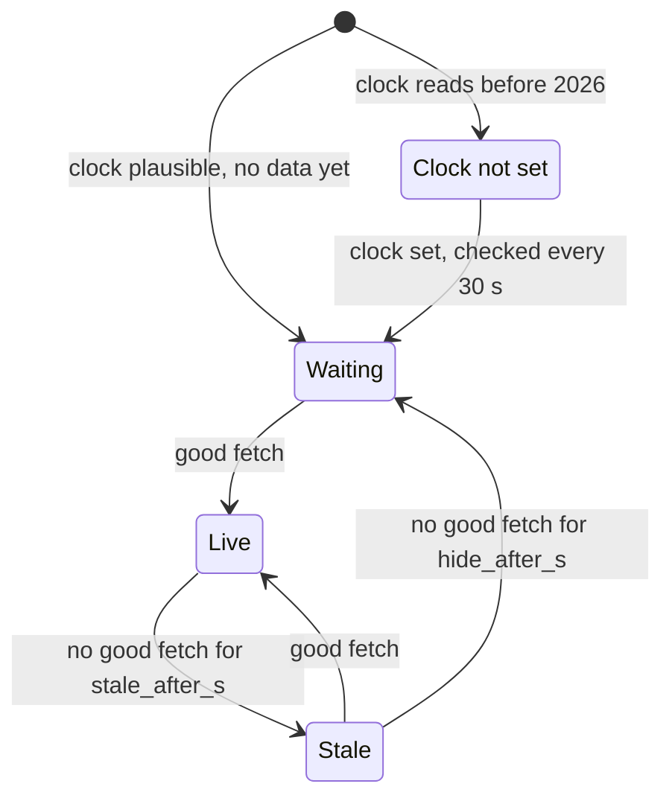

# How it works

This page follows the data from an aircraft's transponder to a pixel on the e-paper panel,
and explains the decisions along the way: which aircraft are featured, how the runways in
use are inferred, when a route is shown, how the radar is drawn, how the display copes with
outages, and how it keeps running for months. For what each element on the screen means,
see [Reading the display](reading-the-display.md); for every setting mentioned here, see
[Configuration](configuration.md).

- [The big picture](#the-big-picture)
- [The pipeline](#the-pipeline)
- [One update, step by step](#one-update-step-by-step)
- [Data freshness](#data-freshness)
- [Choosing the five aircraft](#choosing-the-five-aircraft)
- [Runways in use](#runways-in-use)
- [Routes, only when they check out](#routes-only-when-they-check-out)
- [Weather](#weather)
- [The radar](#the-radar)
- [Rendering for 1-bit e-paper](#rendering-for-1-bit-e-paper)
- [Reliability](#reliability)

## The big picture

Most airliners and many smaller aircraft continuously broadcast their identity, position,
altitude and velocity by ADS-B; volunteers' receivers pick these messages up and share
them with community networks, which anyone can query.



Zurich Air does not receive radio signals itself. Once a minute it asks an aggregator for
every aircraft within a circle around the city, decides what to show, draws a
black-and-white picture and puts it on the display. Besides the traffic, it fetches the
airport's weather report (METAR) every ten minutes, and the route files of the airlines
it sees, which it keeps for a week; the airport and runway data is bundled with the code.
Which services it uses, and on which terms, is described in [Data sources](data-sources.md).

The e-paper driver is not written yet (it is Milestone 6 and waits for the panel). Until
then the same picture is written to `previews/latest.png` by the mock display.

## The pipeline

Every frame goes through the same chain of small modules. The live app and the `preview`
command share it from the parsed snapshot onwards, so a preview shows exactly what the
panel would. The airport line and the routes come from `extras.py`, which owns the METAR
source, the runway monitor and the route table. None of these is needed to draw a frame:
each fails soft, and the frame is drawn without whatever is missing.



| Stage | Module | What it does |
| --- | --- | --- |
| Fetch | `data/provider.py` | Asks the configured sources in order, each with its own rate limit and backoff. |
| Parse | `data/readsb.py` | Turns readsb JSON into `Aircraft` records. Any field may be missing or malformed: a bad value becomes "unknown" and never raises. Only entries without an address or a valid position are dropped. |
| Trails | `processing/history.py` | Remembers recent positions per aircraft, because the services only report where an aircraft is now. |
| Filter | `processing/filtering.py` | Keeps what belongs on the radar (see [below](#choosing-the-five-aircraft)). |
| Phase | `processing/phase.py` | Infers arrival or departure from altitude, vertical rate and track. |
| Rank | `processing/ranking.py` | Scores every candidate and picks the featured aircraft. |
| Weather | `data/metar.py` | Fetches the airport's METAR at most every 10 minutes and keeps the newest observation (see [Weather](#weather)). |
| Runways | `processing/runways.py` | Watches every new snapshot for aircraft clearly landing on or taking off from a runway (see [Runways in use](#runways-in-use)). |
| Scene | `pipeline.py` | `build_scene` combines all of the above with the data's age into a `Scene`: everything one frame shows. |
| Routes | `data/routes.py`, `processing/route_check.py`, `extras.py` | Looks up the scheduled routes of the listed aircraft in a cached table, keeps only those the aircraft is seen flying, and remembers them (see [Routes](#routes-only-when-they-check-out)). |
| Airports | `data/airports.py` | Bundled OurAirports data: the runways of `airport.icao`, the position of every airport on a route, and the IATA codes the display shows. |
| Render | `rendering/` | Draws the scene into a 1-bit image: `renderer.py` composes the header and the footer with the airport line, `radar.py` the scope, `flight_list.py` the rows. The renderer draws exactly the scene and invents nothing. |
| Show | `display/` | `mock.py` writes PNG files. Every backend implements the two-method interface in `display/base.py` (`show`, `close`), the e-paper one included once it exists. |

## One update, step by step

On the Pi, systemd runs `zurich-air run`, which creates an `App` (`app.py`) and calls
`App.tick` once per interval until it is stopped.



In more detail:

1. **Clock check.** If the system clock reads a date before 1 January 2026, the update is
   skipped entirely (no fetch, no drawing) and the app looks again after 30 seconds. See
   [Reliability](#reliability) for why.
2. **Fetch.** The provider is asked for aircraft within `radar.range_km` plus 10 km of the
   radar centre (70 km by default), so that an aircraft entering the scope already has a
   trail. It tries the sources in `provider.sources` order and skips one that is still
   resting after an error or whose minimum request interval has not passed. After HTTP
   429 (rate limited) a source rests for as long as the service's `Retry-After` header
   asks, or 10 minutes without one; after other errors it backs off for 30 s, 1 min,
   2 min, then 5 min. The details are in [Data sources](data-sources.md#fallback-backoff-and-rate-limits).
3. **Parse and remember.** The response is parsed by `data/readsb.py`, and every position
   is added to the track history. New data also goes to the runway monitor: every aircraft
   in it, those on the ground included (see [Runways in use](#runways-in-use)). If no
   source delivered, the last good snapshot is kept and the scene will age (see
   [Data freshness](#data-freshness)).
4. **Weather.** If `weather.interval_s` (600 s) has passed since the last METAR request,
   a new one is made, whether or not traffic arrived (see [Weather](#weather)).
5. **Build the scene.** `build_scene` filters the aircraft, infers flight phases, ranks
   the candidates (passing in the previous frame's flight list, so it stays calm), looks
   up the trails and decides whether the data is live, stale or too old to show. The
   weather and the runways in use go into the scene for the airport line.
6. **Routes.** Once the flight list is known, the featured aircraft get their verified
   routes: remembered from an earlier update, or looked up and checked now (see
   [Routes](#routes-only-when-they-check-out)). Without new data, only remembered routes
   are shown.
7. **Render.** The renderer draws a 400 × 300 image with one bit per pixel.
8. **Show.** The image is compared with the frame already on the display; only a frame
   that differs is sent. If showing fails three times in a row, the app exits so that
   systemd restarts it.
9. **Report.** One line per update goes to the log, for example
   `update: adsb.fi, live, 23 aircraft, featured SWR8 EZY12 DLH4, display refreshed`, and
   once an hour a summary. Then the app tells systemd it is alive (`WATCHDOG=1`).
10. **Sleep.** The next update lands just after the next whole multiple of
    `update.interval_s` (60 s: on the minute, plus one second), and never sooner than two
    seconds after the previous update. During quiet hours (`update.quiet_hours`, 23:30 to
    06:00 by default) the interval is `update.quiet_interval_s` (600 s), but the first
    update after the quiet hours still comes on time. While it sleeps, the app pings the
    watchdog at least every 60 seconds.

## Data freshness

When the services cannot be reached, the display neither freezes on old traffic nor
blanks at the first hiccup. The scene has three states, measured by the age of the last
good fetch (taken from the Pi's own clock when the data arrived, so a service whose clock
runs fast or slow cannot flip the state), and updates pause while the system clock is
not set:



| State | When | Header dot | Radar | Flight list | Footer |
| --- | --- | --- | --- | --- | --- |
| Live | last good fetch at most `update.stale_after_s` (300 s) ago | filled | aircraft and trails, `17 AIRCRAFT` in the corner | featured rows with their routes, or `NO AIRCRAFT` `within 60 km` | airport line, and the source, e.g. `ADSB.FI` |
| Stale | older than that, at most `update.hide_after_s` (1800 s) | hollow ring | last known aircraft, `17 AIRCRAFT` | last rows, with the routes remembered | airport line, and **`NO DATA SINCE 15:31`** |
| Waiting | no data since start, or older than `update.hide_after_s` | hollow ring | empty scope: rings, compass, airport, no count | `WAITING FOR DATA` | airport line, if anything is known, and **`NO DATA SINCE 15:31`**, or just **`NO DATA`** if nothing ever arrived |
| Clock not set | system clock before 2026-01-01 | — | — | — | — |

The range, `60 KM`, is set into the bottom of the outer ring in every state. The time
after `NO DATA SINCE` is the time of the last good data, in `location.timezone`.
Clearing the radar after half an hour means aircraft that are long gone never pass for
current traffic. While the clock is not set, nothing is fetched or drawn, so the display
keeps whatever it showed before.

The airport line keeps its own time. The weather is shown until the observation is older
than `weather.max_age_s` (90 minutes), whatever the traffic data does, so it usually stays
through an outage of the traffic services. A runway stays in use for 20 minutes after the
last aircraft seen using it; without new traffic data nothing new is seen, so the runways
drop out of the line at most 20 minutes after the last good fetch. When parts do not fit
beside `NO DATA SINCE`, they are left out from the end of the line.

Any good fetch returns the display to Live.

## Choosing the five aircraft

### What is on the radar

Before ranking, `processing/filtering.py` decides what is plotted at all. An aircraft is
shown when it is:

- **one entry per ICAO address** (the one with the freshest position);
- **an aircraft**: airport vehicles and obstacles also transmit ADS-B (emitter categories
  C1 to C5) and are dropped;
- **airborne**, unless `aircraft.include_ground` is set. Some transponders report
  "airborne" while parked, so a report slower than 5 kt and no more than 600 ft above
  `airport.elevation_ft` also counts as on the ground;
- **recent**: its position is at most `aircraft.stale_after_s` (60 s) old;
- **below the ceiling** of `aircraft.max_altitude_ft` (60 000 ft); an unknown altitude
  passes;
- **inside the radar range** of `radar.range_km` (60 km) from the centre.

### Scores

The flight list shows the `aircraft.featured` (5) aircraft with the highest scores. A score
is a sum of small, independent components, each looking at one aspect and contributing
points from `[ranking.weights]`:

| Component | Default points | When | `explain` shows |
| --- | --- | --- | --- |
| Emergency | +1000, fixed | squawk 7500, 7600 or 7700, or an emergency status | `emergency 7700` |
| `arrival` | 40 | inferred arrival; full at the airport, half at `ranking.phase_radius_km` | `arrival ZRH 11 km` |
| `departure` | 40 | inferred departure; scaled like arrivals | `departure ZRH 10 km` |
| `notable_type` | 30 | very large or rare types: A124, A337, A388, A3ST, A400, B744, B748, BLCF, C17, IL76, MD11 | `notable A388` |
| `widebody` | 10 | other widebody types | `widebody B77W` |
| `helicopter` | 15 | emitter category A7 or a known helicopter type | `helicopter` |
| `rescue` | 15 | air rescue callsign (prefix `SAZ`, Rega) | `air rescue` |
| `military` | 25 | flagged military in the aircraft database | `military` |
| `interesting` | 15 | flagged interesting in the aircraft database | `flagged interesting` |
| `low_altitude` | 20 | full at 0 ft, fading to nothing at 40 000 ft | `2816 ft` |
| `near_centre` | 10 | full at the radar centre, nothing at its edge | `19 km from centre` |
| `no_identity` | −20 | neither callsign nor type: an uninformative row | `no callsign or type` |
| `featured_before` | 15 | in the flight list of the previous frame | `featured before` |

Emergencies are sorted first whatever the other points; each weight must lie between −100
and 100, and `featured_before` must not be negative. The type lists and the rescue prefix
live in `data/reference.py`; the military and interesting flags come from the data
service's aircraft database (`dbFlags`).

### Arrival or departure

ADS-B carries no flight plan, so the phase is read from the kinematics alone
(`processing/phase.py`). Within `ranking.phase_radius_km` (40 km) of the airport:

- **Arrival:** at or below `ranking.arrival_max_altitude_ft` (10 000 ft), descending at
  least `ranking.min_vertical_rate_fpm` (300 ft/min), or level and no more than 2000 ft
  above the field, with its track within `ranking.max_track_offset_deg` (75°) of the
  direct line to the airport.
- **Departure:** at or below `ranking.departure_max_altitude_ft` (15 000 ft), climbing at
  least 300 ft/min, with its track within 75° of the direct line away from the airport.

The inference is deliberately conservative. Without altitude, vertical rate or track, on
the ground, for helicopters (they fly between pads, not along the runways), or when the
geometry is ambiguous, such as on a downwind leg, there is no phase. The list then shows an
arrow along the track, if there is one, instead of `ARR` or `DEP`: no label rather than a
wrong one.

### Order and stickiness

Candidates are sorted by emergency first, then score, then ICAO address, so the result is
deterministic. On top of that, the list is kept calm, so that the e-paper only changes
when something worth showing does:

- an aircraft that was featured in the previous frame gets the `featured_before` bonus
  (15), so a newcomer must be clearly more interesting to take its place;
- rows stay where they are: aircraft that remain featured keep their order, a newcomer is
  slotted in above the first row it outscores, and rows only move up when one above
  leaves;
- an emergency always goes to the top.

### Privacy

Aircraft whose owners opted out of public tracking (LADD) or that fly with a temporary
privacy address (PIA) are never featured: no number, no row, no callsign. They remain on
the radar as anonymous markers, like any other unfeatured aircraft, and the log never
names them, because it only lists the featured callsigns. `explain` counts them as
"withheld for privacy" without listing them.

### An example

This is the report `zurich-air explain` produces, here for the synthetic `typical` scene:
an invented afternoon at Zürich, with invented weather and routes, not real traffic, hence
`synthetic data` in the first line. `uv run zurich-air explain --scene typical` reproduces
it, without network. The runways in use and the weather head the table as the airport
line shows them. It is trimmed to the first ten rows; the dashed line marks where the
flight list ends.

```text
2026-12-24 15:42:00 · synthetic data · 17 aircraft on the radar, 0 withheld for privacy (LADD/PIA)
runways in use at LSZH: LDG 14 · DEP 28
weather at LSZH, observed 15:20: 270° 8 KT G18 · 4 °C · QNH 1018

  #  FLIGHT    TYPE       ALT    ZRH  PHASE  ROUTE      SCORE  REASONS
  1  UAE87     A388   2816 ft  11 km  ARR    DXB →         90  arrival ZRH 11 km +35, notable A388 +30, 2816 ft +19, 19 km from centre +7
  2  SWR8      B77W   5400 ft  10 km  DEP    → JFK         70  departure ZRH 10 km +35, widebody B77W +10, 5400 ft +17, 13 km from centre +8
  3  EDW24     A359   7100 ft  13 km  DEP    → PUJ         69  departure ZRH 13 km +33, widebody A359 +10, 7100 ft +16, 5 km from centre +9
  4  SAZ3      EC45   2600 ft  18 km         -             57  helicopter +15, air rescue +15, 2600 ft +19, 10 km from centre +8
  5  SWR93D    BCS3   5016 ft  24 km  ARR    LHR →         50  arrival ZRH 24 km +28, 5016 ft +17, 31 km from centre +5
     ---------------------------------------- not featured
  6  OAW726    E295  12000 ft  31 km  DEP    → PMI         45  departure ZRH 31 km +24, 12000 ft +14, 22 km from centre +6
  7  DLH5LU    CRJ9   7000 ft  34 km  ARR    -             42  arrival ZRH 34 km +23, 7000 ft +16, 43 km from centre +3
  8  HBCXB     C172   3500 ft  32 km         -             24  3500 ft +18, 25 km from centre +6
  9  BAW8KN    A320  10000 ft  41 km         -             18  10000 ft +15, 42 km from centre +3
               route LSZH-EGLL not shown: LSZH on the route but no arrival or departure observed
 10  AUA57T    E195  11000 ft  37 km         -             18  11000 ft +14, 41 km from centre +3
```

Row 1 adds up as follows: an arrival 11 km from the airport earns 40 × (1 − 0.5 × 11/40)
≈ 35 points, the A380 is a notable type (30), 2816 ft is low (20 × (1 − 2816/40 000) ≈
19) and it is 19 km from the centre (10 × (1 − 19/60) ≈ 7), 90 in total. The Rega
helicopter in row 4 has no phase, but helicopter and air rescue together lift it above
the later arrivals. The ROUTE column shows the verified route as the list would; row 9 has
a scheduled route through Zürich but no observed arrival or departure to confirm it, so
it gets none (see [Routes](#routes-only-when-they-check-out)).

Run `zurich-air explain` to see the same table for live traffic, a saved snapshot or
another synthetic scene ([Development](development.md#explain-the-ranking)), and see
[Configuration](configuration.md#tune-the-ranking) for adjusting the weights.

## Runways in use

ADS-B says nothing about runways, but geometry does. `processing/runways.py` compares every
aircraft of each new snapshot, airborne or on the ground, with both directions of every
runway of `airport.icao` in the bundled
[OurAirports](data-sources.md#ourairports-airports-and-runways) data (not with
`airport.runways`, which only draws the glyph). A runway end is named as on the display:
`14` is the direction from the threshold of 14 towards that of 32, whether an aircraft
lands or takes off on it.

Each position is measured against a runway end: **along-track**, the distance past the
threshold in the runway direction (negative before it), and **cross-track**, the distance
off the extended centreline. **Height** is the barometric altitude minus
`airport.elevation_ft`; the margins below absorb the difference between pressure altitude
and QNH. An airborne aircraft counts as

| | Landing on an end | Taking off from an end |
| --- | --- | --- |
| Cross-track | at most 0.3 km | the same |
| Track | within 12° of the runway direction | the same |
| Along-track | from 20 km before the threshold to the far end | over the runway, or up to 5 km beyond its far end |
| Height | at most 1500 ft, plus 200 ft for every km before the threshold (a 3° glide path is 172 ft/km) | at most 5000 ft |
| Vertical rate, when reported | not climbing at 300 ft/min or more | climbing at least 300 ft/min |

- **Close to the centreline.** A single position counts only within 0.1 km of the
  centreline. Further out, up to 0.3 km, the aircraft's previous position from the track
  history must lie on the centreline too, behind the current one.
- **Over the runway** only a clear descent (below 1500 ft) or a clear climb decides, so
  that a take-off roll from a transponder that never reports being on the ground is not
  mistaken for a landing. Before the threshold only a landing fits and beyond the far end
  only a take-off, so a missing vertical rate is accepted there.
- **On the ground**, an aircraft rolling along the runway, within 0.1 km of its
  centreline and faster than 40 kt, has just landed if it was airborne when last seen
  (within 3 minutes), and is taking off if it was on the ground and slower.
- **Never counted**: helicopters, aircraft without altitude or track, and positions older
  than 30 s. An aircraft that fits several ends counts for the one nearest its centreline.

**A 20-minute window.** The `RunwayMonitor` remembers which aircraft used which runway end
for 20 minutes. Each aircraft counts once per landing or take-off, and the ends are ranked
by how many aircraft used them, then by the most recent use: `LDG 14 16` means more
aircraft landed on 14 than on 16. One aircraft is enough for a runway to appear. An
aircraft that climbs out along the runway after it was seen landing is going around and
does not count as a departure.

The inference is deliberately conservative: an aircraft that is not clearly lined up with
a runway is ignored, because a wrong runway on the display is worse than none. At night
there may be no evidence at all, and during quiet hours the app looks only every 10
minutes, so it catches fewer aircraft on final; the line then names no runway. Aircraft
established on final at Zürich fly the extended centreline to within metres from 18 km
out; the tolerances suit an airliner airport like Zürich and data every 60 seconds.
`airport.runways_in_use = false` turns the inference off, and so does an `airport.icao`
without bundled runways, with a warning in the log.

## Routes, only when they check out

ADS-B carries no flight plan. Zurich Air takes routes from a table of airline schedules
and shows one only when the aircraft is observed flying it. Otherwise the row shows `ARR`,
`DEP` or an arrow, as it would without routes.

**The table.** The [standing data](https://github.com/vradarserver/standing-data) of
Virtual Radar Server (CC0) maps an airline callsign such as `SWR8` to the ICAO codes of
the airports it serves, in the order flown (`LSZH-KJFK`; a multi-leg route as `A-B-C`). It
keeps one file per airline, and `data/routes.py` downloads only the files of the airlines
actually seen, when they are first needed, and keeps them in `routes.cache_dir`
(`cache/routes`), checking them for changes once a week. A lookup reads one cached file
and searches it for the callsign; nothing but a small index stays in memory. The limits,
and what is sent, are in [Data sources](data-sources.md#vrs-standing-data-routes).

**Which aircraft.** Only airline callsigns are looked up: a three-letter airline code and a
flight number (`EZY0039` is looked up as `EZY39`). Registrations used as callsigns, such as
`HBJVK`, never are. On each update with new data, the featured aircraft are checked
first, then every other aircraft with an inferred arrival or departure, so that one that
joins the list only later, beyond the phase radius, already has its route. Aircraft that
opted out of tracking (LADD) or use a privacy address (PIA) are never looked up. At most
two route files are downloaded per update; a lookup whose file is not cached yet finds no
route and succeeds on a later update.

**The checks** (`processing/route_check.py`). Schedules go stale, airlines reuse a callsign
for the return flight, and crews key in the wrong one, so a scheduled route is accepted
only when it agrees with what the aircraft does:

- **Departure** (`→ JFK`): the [phase inference](#arrival-or-departure) says departing, and
  the route has the local airport (`airport.icao`) as a stop other than the last. The
  destination is the next stop.
- **Arrival** (`DXB →`): the phase says arriving, and the local airport is a stop other
  than the first. The origin is the previous stop.
- **Overflight** (`LHR → IST`): there is no phase, the local airport is not on the route,
  and exactly one leg passes these checks, in this order:
  1. *Heading.* The track points within 30° of the initial great-circle bearing to the
     leg's destination.
  2. *Progress.* The aircraft is nearer the destination than the origin is.
  3. *Origin behind.* The origin lies within 60° of straight behind the aircraft. With the
     heading check, this rejects a callsign reused for the return flight.
  4. *Detour.* Origin to aircraft to destination is at most 1.10 times the direct
     distance. Airliners fly only a few per cent farther than the great circle: verified
     flights came to at most 1.06 (a departure 75 km out to 1.08), while routes that were
     plainly wrong or doubtful came to 1.14 to 1.49.
  5. *Low altitude.* Below 10 000 ft an airliner is climbing out of or descending into an
     airport, so the nearer end of the leg must be within 150 km, and nearer than the
     local airport.
  6. *Early descent.* Descending at 1000 ft/min or more farther than 300 km from the
     destination means descending for somewhere else.

There is deliberately no cross-track limit in kilometres: airway routings stray far from
the great circle (real flights over Zürich were 200 to 290 km off it), so the checks ask
instead whether the aircraft is heading where the route says and has come from where the
route says. Everything else gets no route: no callsign or one that does not match the
route, an aircraft on the ground or with a position older than `aircraft.stale_after_s`,
a phase that the route contradicts, the local airport on the route but no arrival or
departure observed, an airport the bundled data does not know, and a multi-leg route
where more than one leg would fit.

**Remembered.** Once verified, a route is remembered for the aircraft (`RouteMemory` in
`extras.py`) and not checked again. A flight verified as departing within
`ranking.phase_radius_km` keeps `→ JFK` as it flies on to the edge of the radar, where the
departure itself can no longer be told. The route is forgotten when the aircraft changes
callsign, or when it has not been on the radar for 5 minutes, as long as the track history
remembers an aircraft. Updates without new data show the remembered routes and look up
nothing.

**On the display**, each airport is given by the code a passenger knows: its IATA code
from the bundled airport data (`JFK`), else its ICAO code. The arrow reads from origin to
destination; it does not point the way the aircraft flies on the map.

**Measured** once, on live Zürich traffic on one morning: the table had a route for 95% of
the airline callsigns seen. Of the aircraft with a route, 12 of 12 arrivals, 6 of 6
departures and 13 of 17 overflights were verified, and the routes that did not fit the
flight were rejected. These figures come from a single sample, not a guarantee.

**What remains.** The far end of a route lies well beyond the 60 km the display sees and
cannot be checked from here. A flight that keeps its callsign but no longer goes where the
table says would still pass. That is why departures and arrivals lean on the phase
inference, and why anything ambiguous gets no route at all.

`zurich-air explain` shows each verified route in its ROUTE column, and under a row why a
scheduled route was rejected. An excerpt from the synthetic `typical` scene, whose routes
are invented:

```text
  9  BAW8KN    A320  10000 ft  41 km         -             18  10000 ft +15, 42 km from centre +3
               route LSZH-EGLL not shown: LSZH on the route but no arrival or departure observed
 ...
 16  THY7HJ    A21N  37000 ft  47 km         LHR → IST      3  37000 ft +1, 51 km from centre +2
 17  RYR4TR    B38M  39000 ft  39 km         -              3  39000 ft +1, 46 km from centre +2
               route EGSS-LIRA not shown: EGSS-LIRA: track 71 deg off LIRA
```

## Weather

`data/metar.py` asks [aviationweather.gov](data-sources.md#aviationweathergov-the-weather)
for the METAR of `weather.station` (by default `airport.icao`, LSZH) at most every
`weather.interval_s` (600 s), failed attempts included, and keeps the newest observation.
Zürich issues a METAR at 20 and 50 minutes past the hour, available two to six minutes
later, so asking every ten minutes is enough. An observation older than
`weather.max_age_s` (90 minutes) is not shown. The request does not depend on the traffic
data, so the weather stays on the display while that is stale, and while waiting for it.

From each observation the airport line shows:

- **Wind**: the direction in degrees true with three digits, as in the METAR, the speed in
  knots and gusts when reported above the mean speed: `270° 8 KT G18`. `VRB 12 KT` is a
  variable direction, `CALM` no wind; without a direction, the speed stands alone.
- **Temperature** in °C, with a real minus sign: `−3 °C`.
- **QNH**: the pressure in hPa that altimeters are set to near the airport, `QNH 1018`.

The runways in use come first in the line, then wind, temperature and QNH; when the line
does not fit beside the source or `NO DATA SINCE`, parts are left out from its end.
Parsing never raises: a malformed value becomes unknown and is left out. A failed request
is one warning in the log, such as `metar LSZH: timed out; next try in 600 s`.
`zurich-air explain` prints the observation, with the METAR as issued, above its table.
`weather.enabled = false` turns the weather off.

## The radar

**Projection.** The scope uses an azimuthal equidistant projection centred on
`location`: every aircraft is placed at its true great-circle distance and initial
bearing from the centre, north up. Within a radius of some 100 km this is effectively
exact and needs no map library (`processing/geo.py`). At 400 × 300 px the scope has a
radius of 112 px, so 60 km come to about 1.9 px per km.

**Scale.** The outer ring is solid and marks `radar.range_km` (60 km). Dotted inner rings
follow every `radar.ring_step_km` (20 km); their dots are 7 px apart, sparse enough to
recede behind the traffic. Compass ticks sit inside the outer ring every 10°, longer at
30° and 90°, with an `N` set into the ring at the top. A small cross marks the centre.

**Airport.** The runways from `airport.runways` are drawn as a glyph: the real layout,
enlarged around its centre to a radius of 9 px, so that the runway directions can be
read. Without runway data, a small ring marks the airport. The airport code goes beside
the glyph on the first side that is free of aircraft and badges (right, left, below,
above, then the corners), and is left out when traffic surrounds the airport.

**Aircraft.** Featured aircraft are drawn as a 15 px airliner silhouette (a helicopter seen
from above for helicopters), all others as a 9 px dart, each rotated to its track; an
aircraft without a track is a small square. The symbols are rasterised at 8× and
thresholded, which keeps them symmetric at these sizes, and each gets a one-pixel white
halo so that it stands out from rings and trails. Featured aircraft are drawn last, with
#1 on top.

**Trails.** Each aircraft keeps up to 8 positions from the last 10 minutes (an aircraft not
reported for 5 minutes is forgotten). Its trail is drawn as dots that start 2 px apart and
grow sparser with distance, so it fades out instead of ending abruptly, and is capped at
28 px behind featured aircraft and 18 px behind others, so fast jets do not streak across
the scope. Dotted, a trail never reads as a leader line; dense, never as a range ring.
Traffic is clipped to the scope's circle.

**Badges.** Each featured aircraft carries a numbered black badge (9 × 11 px), joined to
its marker by a short leader line, as in an air traffic controller's data block, so every
number points at exactly one aircraft even in the cluster around the airport. Badges are
placed in list order. For each one, 16 directions (horizontal, vertical, 45° and regular
2:1 staircases, so every leader is a crisp line) and every leader length from 5 to 24 px
are scored:

- covering another marker, badge, leader or landmark is all but ruled out, as is leaving
  the scope;
- lying among the compass ticks, covering trails or runway strokes, or sitting within
  12 px of another aircraft (where it could be read as that aircraft's label) costs
  points;
- so does pointing into a crowd rather than away from it, or along the aircraft's track
  ahead (it would read as a speed vector) or astern (along its trail);
- shorter leaders and the up-and-right direction are preferred when all else is equal.

The cheapest position wins and is blocked for the badges that follow. If no position
inside the scope exists, the badge sits on its aircraft.

## Rendering for 1-bit e-paper

The panel shows black or white, nothing in between, so the renderer works in Pillow's
mode `"1"` from the start rather than converting a greyscale picture at the end.

- **Typeface.** All text is [B612](https://github.com/polarsys/b612), the typeface Airbus
  designed for cockpit displays, bundled under the SIL Open Font License. Drawn onto a
  1-bit image, it is rasterised without anti-aliasing, so every glyph lands on whole
  pixels.
- **Four sizes.** 13 px for the header and 14 px for callsigns (both bold), 10 px for
  altitudes, second lines and the footer, 9 px for radar labels and badge digits. At these
  sizes B612's hinted Regular cut sits on a perfectly even baseline.
- **Synthetic bold.** Bold is Regular struck twice, one pixel apart. B612's Bold cut ships
  without hinting instructions, and FreeType's auto-hinter would set some letters one
  pixel higher than others: a visible wobble in 1-bit. Only the Regular cut is bundled.
- **Placed by ink.** Text is positioned by its baseline and the edges of its actual ink,
  so left and right edges line up exactly across rows. Letter-spaced labels are set glyph
  by glyph with an even gap between the inked shapes.
- **Same pixels everywhere.** Fonts are loaded with Pillow's basic layout engine. Pillow
  builds with libraqm (as on Linux, so on the Pi) would otherwise shape text with
  HarfBuzz and set it at different widths than builds without it (as on macOS); with the
  basic engine, a preview on a laptop matches the panel pixel for pixel.
- **Small symbols by hand.** Arrows point in one of eight directions and are drawn as
  1 px lines like the strokes of the text beside them; climb and descent marks are solid
  triangles.
- **Shortened by meaning.** When the operator and model do not fit, the description gives
  way step by step (`Swiss · 777-300ER` → `Swiss · 777` → `777-300ER` → `777`), never with
  an ellipsis. Missing fields are left out; nothing is guessed.

## Reliability

The device is meant to hang on a wall for months without anyone looking after it.

**No single failure stops the display.** Each stage of an update (fetch, build, render,
display) is guarded. A provider error keeps the last good data, shown stale and later
hidden. An unexpected exception is logged, with its full traceback at most once an hour
for each kind, and the next update carries on.

**The airport line and the routes never stop a frame.** METAR and route requests never
raise: a failure is one warning line, after which the METAR waits for its next interval
and the route table rests for 30 s, then 60 s, 120 s and 300 s after further failures in a
row, or as long as an HTTP 429 asks. An unexpected error in the weather, the runways in use
or the routes is logged once, until that part works again, and the frame is drawn without
it.

**Time per update.** In the worst case every request times out: `provider.timeout_s` for
each traffic source tried (2 × 10 s by default), one METAR request (5 s) and two route
downloads (5 s each), 35 s in all, plus rendering and the panel. The METAR and route
requests together add at most 15 s (`MAX_EXTRA_S` in `extras.py`). Each timeout bounds a
blocking socket operation; DNS lookups are not covered. `tests/test_deploy_files.py`
checks that this worst case stays at least 20 s below `update.interval_s`, leaving time
for DNS and the panel, and `tests/test_extras.py` that the 15 s stay within a quarter of
the interval. The runway inference and the route checks take a few milliseconds.

**Watchdog.** The systemd service is of `Type=notify`. The app reports `READY=1` when it
starts, `WATCHDOG=1` after every update and at least every 60 seconds while it waits
(also during the 10-minute quiet-hours interval), and `STOPPING=1` when it stops. An
update takes a minute at most, even when every request times out, so with
`WatchdogSec=5min` five minutes of silence mean the process hangs, and systemd kills and
restarts it.

**Restarts.** `Restart=always` restarts the service after a crash, a watchdog timeout or a
deliberate exit. Restarts back off: 30 s, 1 min, 2 min, 5 min, then every 10 minutes. The
only deliberate exit is a display that fails three times in a row: the app then exits
with status 1, so that systemd starts it afresh.

**Quiet hours.** From 23:30 to 06:00 local time the app updates every 10 minutes instead of
every minute: fewer requests to the data services and fewer panel refreshes while there is
little traffic.

**Small footprint.** The mock display keeps only `latest.png`, replaced atomically so that
a reader never sees half a file; keeping every frame (`--keep-frames`) would fill the SD
card at some 6 MB a day. The track history is bounded too (8 positions per aircraft, at
most 2000 aircraft). The route cache holds one file per airline seen, a downloaded file of
1 to 250 kB reduced to `callsign,airports` lines, each replaced in one step so that a power
cut never leaves half a file behind.

**Starting without a synchronised clock.** The Pi has no battery-backed clock and boots
with a time from the past until NTP corrects it over the network. The service waits for
the network (`After=network-online.target`) but deliberately not for time
synchronisation: with the network down at boot it would never start, and the panel would
keep its last picture, live dot included. Instead it starts at once and shows
`WAITING FOR DATA`. Only while the clock reads a date before 2026 does it neither fetch
(HTTPS would fail anyway) nor draw a wrong time, and it checks again every 30 seconds.

**Logs.** One line per update, a summary every hour, warnings and errors with their
journal priority (so `journalctl -u zurich-air -p warning` lists only problems). See
[Troubleshooting](troubleshooting.md) for what the messages mean and
[Raspberry Pi setup](raspberry-pi.md) for the service itself.
