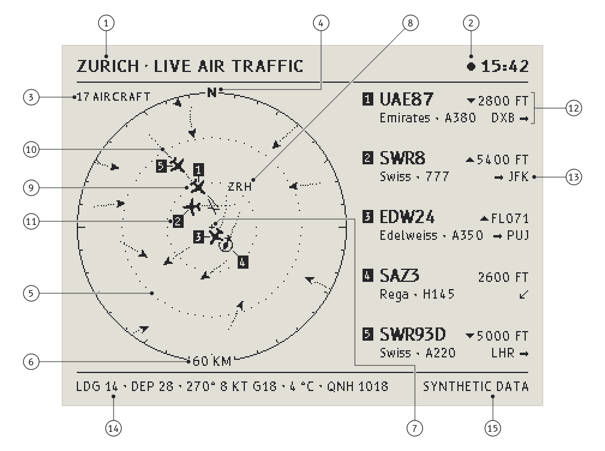
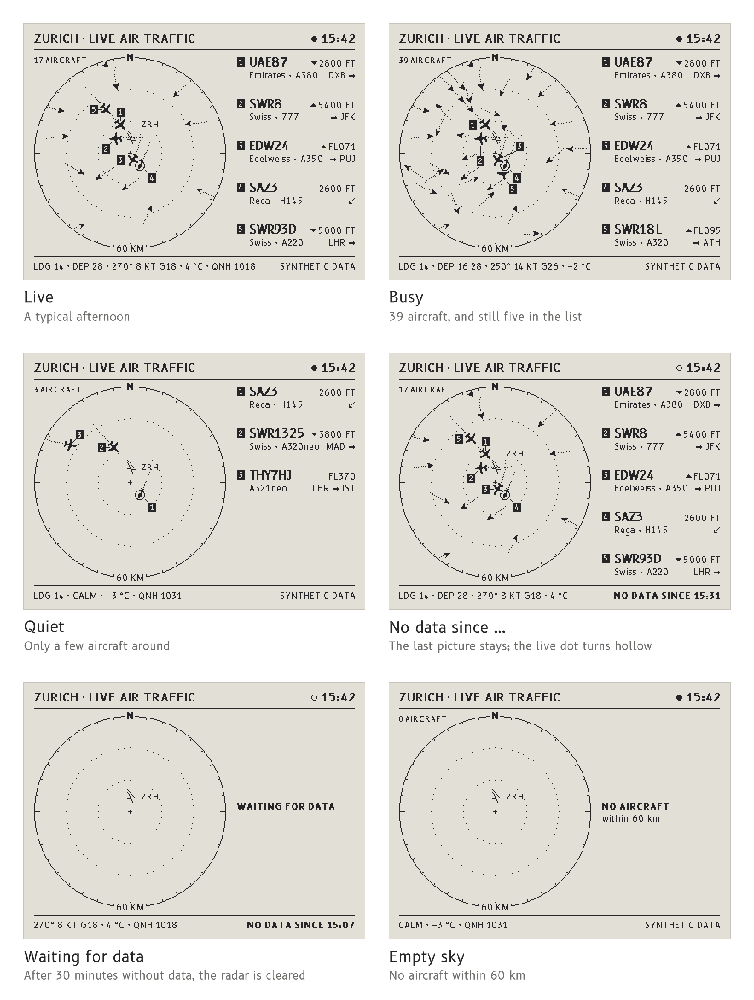
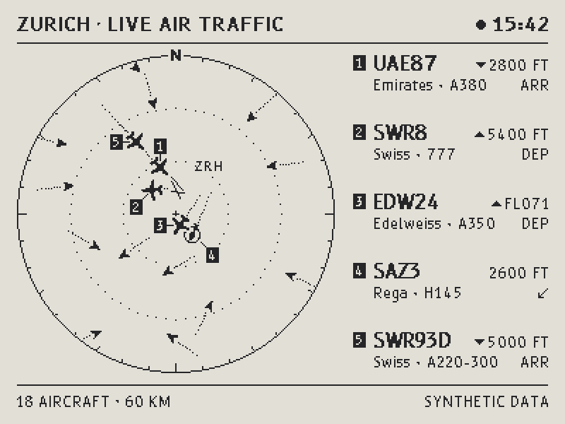

# Reading the display

Zurich Air shows the air traffic around Zürich as an air traffic controller might see it:
a round radar on the left and, on the right, the five aircraft most worth a look. This
page explains everything on the screen. No technical knowledge needed.



<sub>Rendered from synthetic data: every flight in these pictures is invented.</sub>

1. **Title.** The place the radar is centred on.
2. **Live dot and clock.** The time of the last update. The dot is filled while fresh
   data is arriving and turns into a hollow ring when it is not (see
   [When something is different](#when-something-is-different)).
3. **Aircraft count.** How many aircraft are on the radar right now.
4. **North.** North is always at the top. The ticks around the edge mark every 10°, with
   longer ones every 30° and at north, east, south and west.
5. **Range rings.** The dotted rings are 20 km and 40 km from the centre; the solid edge
   is 60 km away.
6. **Range.** How far the radar reaches: its edge is 60 km from the centre.
7. **Zürich.** The small cross in the middle is the centre of Zürich.
8. **Zürich Airport.** Its three runways, drawn a little larger than to scale so that
   you can make them out, and its code, ZRH. When aircraft crowd around the airport the
   code is left out rather than drawn half hidden.
9. **An aircraft.** Each symbol points in the direction the aircraft is flying.
10. **Trail.** The dotted line behind an aircraft shows where it has just been.
11. **Number badge.** Ties an aircraft on the radar to the row of the list with the same
    number.
12. **A row of the flight list.** Who it is, how high it is, and where it is going.
13. **Route.** Where a flight comes from or goes to: `→ JFK` is on its way to New York,
    `DXB →` comes from Dubai (see
    [Routes, ARR, DEP and the arrows](#routes-arr-dep-and-the-arrows)).
14. **Airport line.** The runways Zürich is using and the weather at the airport (see
    [The airport line](#the-airport-line)).
15. **Data source.** Where the data comes from, or since when none has arrived. The real
    display names a community network of receivers here, such as `ADSB.FI`; these
    pictures say `SYNTHETIC DATA` because their traffic, weather and routes are made up.

The display updates every minute, just after the minute turns.

## The radar

The radar is a map seen from above, with north up and Zürich in the middle. Distances on
it are true to scale: an aircraft halfway between the centre and the edge is 30 km away.
Only the airport symbol is drawn larger than life.

**Aircraft.** The five aircraft in the list are drawn as small aeroplanes (helicopters as
a helicopter seen from above, with its rotor disc), each with its number badge. All other
aircraft are small arrowheads. Both point the way the aircraft is moving. An aircraft
whose direction is not known is a small square.

**Trails.** The dots behind an aircraft are its last positions. They are dense right
behind it and thin out further back. Trails are kept short so that fast jets do not
streak across the screen: at most about 15 km on the map for the numbered aircraft and
about 10 km for the others. For an airliner at cruising speed that is roughly the last
minute; for a slow helicopter, several minutes. An aircraft that has only just appeared
may not have a trail yet.

**What is left out.** Aircraft on the ground, aircraft whose last position is over a minute old,
and anything beyond 60 km.

## The list

```
▮1 UAE87          ▼ 2800 FT
   Emirates · A380    DXB →
```

Each row has two lines:

- **Call sign**, in bold: the name the flight uses on the radio, an airline code plus a
  flight number (`SWR8` is Swiss, `EDW24` Edelweiss, `SAZ3` Rega). An aircraft without
  one shows its registration (`HB-CXB`), or else its transponder address, six letters and
  digits such as `4B1805`. A name too long for the row ends in "…".
- **Altitude**, with ▲ when the aircraft is climbing and ▼ when it is descending (by at
  least 300 feet per minute; no triangle: level flight, or not known). See
  [Units](#units).
- **Airline and aircraft type**, such as `Emirates · A380`. When the row is too narrow
  the display shortens this by meaning, never mid-word: `Swiss · A220-300`, then
  `Swiss · A220`, then `A220-300`, then `A220`. Whatever is unknown is left out; the
  display never guesses.
- **Where it is going**, on the right: its route (`DXB →`, `→ JFK`, `LHR → IST`), else
  `ARR`, `DEP` or an arrow (see
  [Routes, ARR, DEP and the arrows](#routes-arr-dep-and-the-arrows)).

### How the five are chosen

Every aircraft on the radar collects points for what makes it worth a look, and the five
with the most points get a row. With the standard settings:

| What                                                                | Points          |
| ------------------------------------------------------------------- | --------------- |
| Landing at or just taken off from Zürich (`ARR` / `DEP`)            | up to 40        |
| Very large or rare: A380, Boeing 747, An-124, Beluga, C-17, A400M … | 30              |
| Military                                                            | 25              |
| Flying low                                                          | up to 20        |
| Helicopter                                                          | 15              |
| Air rescue (Rega)                                                   | 15              |
| Flagged as interesting in the aircraft database                     | 15              |
| Already in the list                                                 | 15              |
| Other wide-body jets (A330, A350, 777, 787 …)                       | 10              |
| Close to the centre of Zürich                                       | up to 10        |
| Neither call sign nor type known                                    | −20             |

Arrivals and departures count fully at the airport and half as much 40 km away. Flying
low counts fully at ground level and not at all from 40 000 ft. Closeness counts fully at
the centre and not at all at the edge of the radar. A Rega helicopter collects both the
helicopter and the rescue points.

**Emergencies always come first.** If an aircraft signals an emergency (pilots set a
special transponder code for this), it goes to the top of the list, with `EMERGENCY` in place of its
airline and type.

**The list stays calm.** An aircraft already in the list keeps a bonus, so it is only
replaced when a newcomer is clearly more interesting. Rows do not swap places: aircraft
that stay keep their order, a newcomer slides in above the first row it beats, and rows
only move up when one above them leaves.

Fewer than five aircraft around means fewer rows. The points can be tuned in the
configuration; see [Configuration](configuration.md).

## Units

| On the display | Means                                                               |
| -------------- | ------------------------------------------------------------------- |
| `5400 FT`      | 5,400 feet, rounded to the nearest 100 feet. Used below 7,000 feet. |
| `FL071`        | Flight level 71: 7,100 feet.                                        |
| `FL350`        | Flight level 350: 35,000 feet, about 10.7 km. A cruising altitude.  |
| `GND`          | On the ground (only if the display is set to show those).           |
| `60 KM`        | Distances are in kilometres.                                        |

From 7,000 feet up, altitudes are given as flight levels, in hundreds of feet, the way
pilots and controllers in Switzerland say them. Altitudes are above sea level, not above
the ground below: Zürich Airport itself lies at 1,416 feet (432 m). One foot is about
30 cm, so 1,000 feet is about 300 m. If you would rather read metres, the display can
show altitudes as `10 360 M` instead; see [Configuration](configuration.md).

## Routes, ARR, DEP and the arrows

- **A route**: where the flight comes from or goes to, by the airport codes printed on
  boarding passes (`JFK` is New York, `DXB` Dubai, `LHR` London Heathrow):
  - `DXB →`: landing at Zürich, coming from Dubai;
  - `→ JFK`: just took off from Zürich, on its way to New York;
  - `LHR → IST`: passing over, from London to Istanbul.

  The arrow reads from where the flight comes from to where it goes; it does not point
  the way the aircraft flies on the map. A route is shown only when the aircraft is seen
  flying it (see below), so many rows have none. Once shown, it stays with the aircraft:
  a flight to New York keeps `→ JFK` all the way to the edge of the radar.
- **`ARR`**: the aircraft is coming in to land at Zürich. It is within 40 km of the
  airport, below 10,000 feet, descending (or level and very low) and heading towards it.
- **`DEP`**: the aircraft has just taken off from Zürich. It is within 40 km of the
  airport, below 15,000 feet, climbing and heading away from it.
- **An arrow** (↑ ↗ → ↘ ↓ ↙ ← ↖): neither of these; the arrow shows which way the
  aircraft is flying, rounded to the nearest of eight directions, with north up as on
  the radar.

The aircraft's radio signals carry no flight plan, so the display works this out from
how it moves, and says `ARR` or `DEP` only when that is clear. Routes come from a public
table of airline schedules, and schedules are not always right: the display shows a route
only if the aircraft really behaves like it, landing at Zürich for a route that ends
there, taking off for one that starts there, or flying towards the destination and away
from the origin when passing over. When in doubt, it shows no route. A plane on its way in
that is still flying away from the airport to line up shows an arrow until it turns
towards the airport. Helicopters never get `ARR` or `DEP`: they fly between their own
landing sites.

## The airport line

```
LDG 14 · DEP 28 · 270° 8 KT G18 · 4 °C · QNH 1018
```

The left of the footer tells you how things stand at Zürich Airport:

- **`LDG 14`**: aircraft are landing on runway 14, **`DEP 28`**: taking off from
  runway 28. Several runways are listed busiest first (`LDG 14 16`). A runway is named
  after the direction it points to, in tens of degrees: runway 28 points roughly west
  (about 280°). The display works the runways out by watching aircraft line up with
  them, so a runway appears only after an aircraft has used it in the last 20 minutes;
  at night there may be none.
- **`270° 8 KT G18`**: the wind blows from 270° (the west) at 8 knots (about 15 km/h),
  with gusts of 18 knots. `VRB` means a variable direction, `CALM` no wind at all.
  Aircraft take off and land into the wind, which is why the wind decides the runways.
- **`4 °C`**: the air temperature at the airport.
- **`QNH 1018`**: the air pressure in hectopascals that pilots set their altimeters to.
  High pressure (1030 and more) usually means settled weather, low (below 1000) unsettled.

The weather is the airport's latest official report (a METAR), issued every half hour.
When the line is too long, the least important parts are left out, starting at the end.
Whatever is not known is left out too: without a recent report there is no weather, and
when nothing is known at all the left of the footer stays empty.

## When something is different



<sub>Rendered from synthetic data.</sub>

- **Live.** The dot is filled and the footer names the data source.
- **Busy or quiet.** However many aircraft are around, the list keeps to the five most
  interesting.
- **NO DATA SINCE 15:31.** No new data has arrived for more than 5 minutes, for example
  because the Wi-Fi or the data service is down. The last picture stays on the screen,
  the dot turns hollow and the footer says in bold since when there has been no data.
  The airport line stays as long as its reports are recent enough.
  The clock keeps running. Nothing needs doing: the display keeps trying and goes back
  to normal as soon as data arrives.
- **WAITING FOR DATA.** After 30 minutes without data the radar and the list are
  cleared, so that aircraft long gone are never shown as if they were still there. Just
  after switching on, before the first data has arrived, the footer says `NO DATA`.
- **NO AIRCRAFT within 60 km.** Data is arriving, but nothing is flying nearby. Late at
  night you may see this often.

**Quiet hours.** Between 23:30 and 06:00 the display updates only every 10 minutes
instead of every minute, so at night the clock can be up to 10 minutes behind. The first
update after 06:00 comes on time.

If the clock stops moving for longer than that, the display has stopped updating; an
e-paper screen keeps its last picture even without power. See
[Troubleshooting](troubleshooting.md).

## Why some aircraft have no name

- **On the radar, only the numbered aircraft have a name**, in the list. All others are
  unlabelled symbols, to keep the radar readable.
- **Some owners ask not to be tracked.** Aircraft whose owners have opted out of public
  tracking, or that fly with a temporary anonymous address, are never put in the list,
  however interesting they are, and the display never looks up their route. They appear
  only as an unnumbered symbol on the radar, and are counted in its corner.
- **Sometimes the name is simply not known.** Not every aircraft sends a call sign. The
  row then shows the registration or the transponder address instead, and the second
  line can be shorter or empty: the airline is only known for the airline call signs in
  its built-in list, and the display never guesses.

## Minute by minute



<sub>Synthetic data, one frame per minute; each aircraft simply flies straight on. Watch
the trails follow the aircraft, the arrivals land and drop off the radar, and newcomers
take a row only when they beat the aircraft already listed.</sub>
